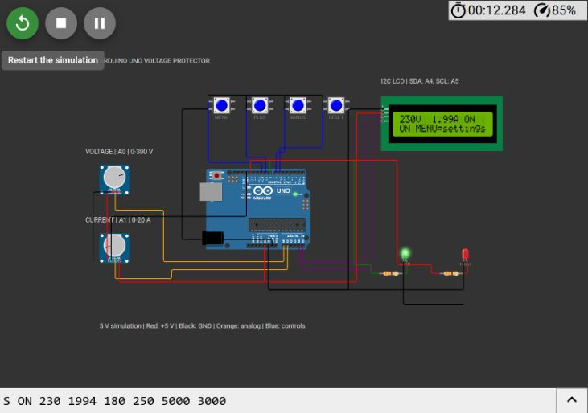
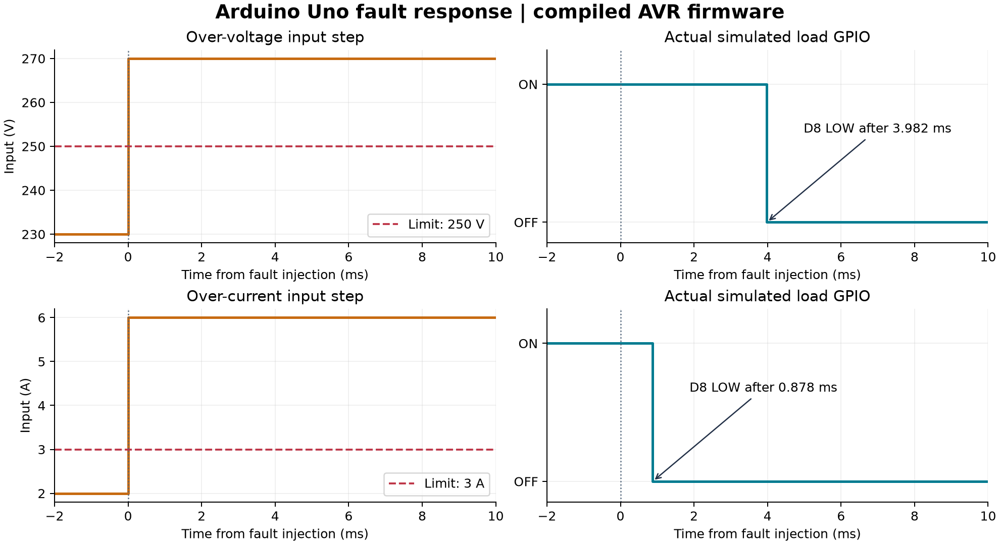

# Arduino Uno Voltage Protector

Arduino Uno R3 project for FSMB Recruitment 2026, Phase 1. It detects voltage/current faults, opens a simulated load connection, and supports settings from local buttons or a computer.

**[Run the saved Wokwi simulation](https://wokwi.com/projects/477495301282380801)**



## Features

- Under-voltage, over-voltage, over-current and ADC-saturation detection.
- Load OFF at startup; continuous safe-input qualification before connection.
- Latched faults and safe manual reset.
- Local MENU, PLUS, MINUS and RESET buttons.
- 16x2 I2C LCD and USB serial configuration at 115200 baud.
- Incremental LCD refresh, bounded serial processing and I2C transaction timeout.
- Shared settings validation and timer-rollover handling.

## Circuit

The simulation is powered at 5 V. Two potentiometers represent 0-300 V and 0-20 A. The green LED represents the connected load; the red LED indicates a latched fault. No mains circuit is included.

| Part | Arduino connection |
|---|---|
| Voltage / current potentiometer wipers | A0 / A1 |
| Potentiometer outer terminals | 5 V and GND |
| I2C LCD SDA / SCL | A4 / A5 |
| I2C LCD VCC / GND | 5 V / GND; address 0x27 |
| MENU / PLUS / MINUS / RESET buttons | D10 / D9 / D7 / D6; other contact to GND |
| Green LOAD LED | D8 through 330 ohm resistor; cathode to GND |
| Red FAULT LED | D13 through 330 ohm resistor; cathode to GND |
| Computer communication | Uno USB serial |

Inputs are on the left, buttons above the Uno, LCD at the upper right and load indicators at the lower right. Red wires are 5 V, black are GND, orange are analog, blue are buttons and purple are I2C. Wire crossings do not imply a junction; connections are determined by endpoints in `diagram.json`.

See [wiring details](schematics/wiring.md) and the [block diagram](schematics/block_diagram.svg).

## Run in Wokwi

1. Open the saved project and click Start. Keep the preset inputs around 230 V and 2 A. After LCD initialization and three seconds of safe-input qualification, the green LED turns on.
2. Raise voltage above 250 V. The load turns OFF and `OV` appears. Restore 230 V: the fault remains latched. Press RESET and wait three seconds to reconnect.
3. Raise current above 5 A to demonstrate `OC`. Restore a safe current and reset. Voltage below 180 V demonstrates `UV`.
4. Press MENU to select VMIN, VMAX, IMAX or DELAY. PLUS/MINUS change the selected value. A valid change opens the load and restarts qualification. MENU cycles back to the monitor page.
5. Expand Serial Monitor and send the commands below **one at a time**, waiting for a response or fresh status before the next command.

To import into a new Wokwi project, copy `project_files/wokwi/sketch.ino`, `Protection.h`, `diagram.json` and `libraries.txt` into tabs with those exact names. Install **LiquidCrystal_I2C 2.0.0**.

## Settings and protection

| Setting | Default | Valid range | Button step |
|---|---:|---:|---:|
| VMIN | 180 V | 80-230 V | 1 V |
| VMAX | 250 V | 200-280 V | 1 V |
| IMAX | 5000 mA | 1000-15000 mA | 500 mA |
| DELAY | 3000 ms | 1000-30000 ms | 1000 ms |

VMAX must be at least 20 V above VMIN. A trip is `V < VMIN`, `V > VMAX`, `I > IMAX`, or either ADC reading at/above 1022. The first fault stays latched. RESET requires `VMIN + 5 <= V <= VMAX - 5` and `I <= IMAX - 500`. Inputs must stay within this recovery band for the entire restart delay. A new trip during qualification latches again.

No command forces the load ON. Settings are held in RAM and return to defaults on restart. The simulated current knob remains an independent input even while the load LED is off. Conversion is `V = floor(ADC_A0 * 300 / 1023)` and `mA = floor(ADC_A1 * 20000 / 1023)`.

## Computer commands

Use 115200 baud with Newline/LF enabled. Values are integers; current is in milliamps and delay in milliseconds.

```text
GET
SET VMAX 245
SET IMAX 4000
SET DELAY 5000
RESET
```

`OK` confirms a valid change. An unsafe RESET returns `ERR UNSAFE`. Invalid limits return `ERR RANGE`; for example, `SET VMAX 0` leaves the previous limit unchanged. Other errors identify malformed, unknown or oversized commands. A busy UART may skip a reply; wait and send GET again.

Status format, sent every 500 ms:

```text
S STATE voltage_V current_mA VMIN VMAX IMAX DELAY_ms
S ON 230 1994 180 250 5000 3000
```

States: `WAIT`, `ON`, `UV`, `OV`, `OC`, `SENSOR`.

## Physical Uno setup

1. Follow `schematics/wiring.md`. Use an I2C LCD with a PCF8574 backpack at address 0x27 and adjust its contrast trimmer.
2. Open `src/VoltageProtector/VoltageProtector.ino` in Arduino IDE; keep `Protection.h` in the same folder.
3. Install Arduino AVR Boards and **LiquidCrystal_I2C 2.0.0**, select Arduino Uno and the correct COM port, then Verify and Upload.
4. Set safe inputs and open Serial Monitor at 115200 baud with Newline enabled.

Optional USB control panel:

```powershell
python -m pip install pyserial
python src/pc_control.py
```

Close Serial Monitor first. The panel connects to a physical Uno; the browser simulation uses Wokwi's serial monitor. Its source is syntax-checked, but a physical USB session has not been tested. Opening a Uno serial port may reset the board.

## Verification

**37 protection tests and 19 firmware integration checks passed.** Compiled ATmega328P code runs in AVR8js 0.21.0. Tests model ADC, GPIO, timer, USART and I2C transaction timing; LCD appearance is demonstrated in Wokwi.

The final build uses **9,194 bytes flash** and **920 bytes static RAM** with Arduino AVR core 1.8.8. Two fault injections disconnected simulated D8 after **3.982 ms (OV)** and **0.878 ms (OC)**. These individual simulator observations are not worst-case or physical timing guarantees.

See the [evidence index](test_evidence/readme.md) for actual Wokwi screenshots, exported serial output, automated logs, CSV/JSON event records, VCD capture, timing plots and firmware hashes.



Reproduce from the repository root with Arduino CLI, Node.js/npm and Python installed:

```powershell
python project_files/sync_project.py
arduino-cli core install arduino:avr
arduino-cli lib install LiquidCrystal_I2C@2.0.0
arduino-cli compile --fqbn arduino:avr:uno --output-dir project_files/build/firmware src/VoltageProtector
arduino-cli compile --fqbn arduino:avr:uno --output-dir project_files/build/selftest project_files/tests/selftest
npm install --prefix project_files
node project_files/tests/run_avr.cjs project_files/build/selftest/selftest.ino.hex
node project_files/tests/integration.cjs project_files/build/firmware/VoltageProtector.ino.hex test_evidence/integration.txt
python -m pip install matplotlib
python project_files/plot_timing.py
```

## Design report

See [design_document.pdf](design_document.pdf) for the one-page design approach, implementation, results and limitations.

## Repository structure

```text
src/                         Arduino source and optional computer panel
schematics/                  Block diagram and wiring guide
project_files/               Wokwi project, AVR tests and helper scripts
test_evidence/               Screenshots, logs and timing captures
design_document.pdf          One-page report
readme.md                    Setup and operation
```

Canonical firmware is in `src/VoltageProtector/`. After edits, run `project_files/sync_project.py` to refresh Wokwi and test copies. Generated builds, caches and LaTeX auxiliary files are excluded from Git.

## Limitations

The demonstration uses DC stand-ins and an LED output. It does not include AC RMS measurement, physical relay/contact verification, persistent settings or an independent hardware cutoff. Sampling is nominally every 5 ms; the LCD updates one character per loop, and very short transients can still be missed. Physical calibration and timing tests would be needed for a hardware product. No mains circuit was built.

## References

- [Arduino Uno R3](https://docs.arduino.cc/hardware/uno-rev3/)
- [Wokwi LCD1602](https://docs.wokwi.com/parts/wokwi-lcd1602)
- [Wokwi serial monitor](https://docs.wokwi.com/guides/serial-monitor)
- [AVR8js](https://github.com/wokwi/avr8js), MIT license, Uri Shaked and contributors
- [LiquidCrystal_I2C](https://github.com/markub3327/LiquidCrystal_I2C)
